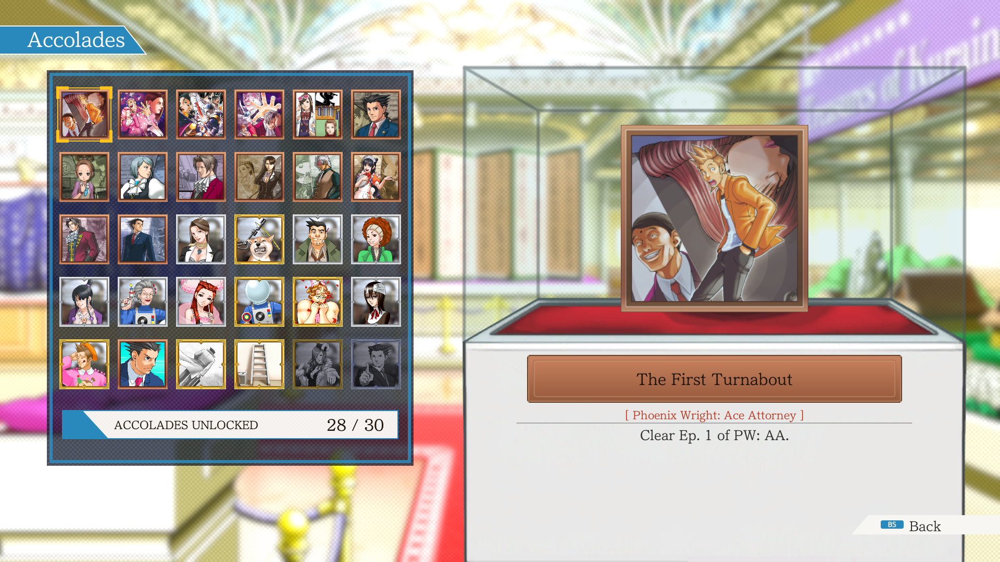

# Phoenix Wright: Ace Attorney Trilogy - xMod

[English](README.md) | [Español](README_es.md) | [Italiano](README_it.md) | [Português (BR)](README_pt.md) | [Français](README_fr.md) | **Deutsch** | [日本語](README_ja.md) | [한국어](README_ko.md) | [简体中文](README_zh_cn.md) | [繁體中文](README_zh_tw.md)

**PWTrilogy-xMod** ist eine von der Community entwickelte Erweiterung und Inhaltsaktualisierung, die darauf ausgelegt ist, *Phoenix Wright: Ace Attorney Trilogy* in die **definitive Edition** des Spiels zu verwandeln.

Es handelt sich um eine umfassende Modifikation, die das Spielerlebnis um neue interaktive Bereiche, Quality-of-Life-Verbesserungen (QoL), einen dynamischen Orchester-Soundtrack, native 64-Bit-Unterstützung für Linux (Steam Deck) und Windows sowie mehrsprachige Koexistenz erweitert, ohne CAPCOMs offizielle Sprachen anzutasten.

---

## Hauptfunktionen

### Neue koexistierende Sprachen
- **Europäisches Spanisch**: Übersetzung, grafische Benutzeroberfläche und synchronisierte Sprachausgabe, angepasst von **Traducciones Kurain**.
- **Italienisch**: Vollständige Lokalisierung, entwickelt vom **Dragon Punk Team**.

### Interaktive Auszeichnungsgalerie (Accolades Gallery)

- Neuer interaktiver Raum im Menü **Galerie** mit 3D-Vitrinen und Rahmen nach Kategorien (Bronze, Silber und Gold).
- **Zwei-Wege-Steam-Synchronisation**: Erkennt und synchronisiert automatisch auf Steam freigeschaltete Erfolge und ermöglicht es, offline verdiente Auszeichnungen nachträglich auf dein Konto hochzuladen.
- Pop-up-Benachrichtigungen im Spiel beim Freischalten von Auszeichnungen.

### Dialogverlauf

- Sieh dir vorherige Gespräche jederzeit während des Spiels erneut an.

### Orchestraler Soundtrack im Spiel
- Neue Option im Spiel, um während der gesamten Geschichte zwischen dem Original-Soundtrack und den Orchesterarrangements zu wechseln.

### Erweitertes Musikzimmer

- Neue Titel wurden dem Musikplayer der Galerie hinzugefügt, einschließlich des Albums *„Gyakuten Meets Orchestra“*.

### Native 64-Bit-Multiplattform-Unterstützung
- **Natives Linux (64-Bit)**: Native ausführbare Datei und Bibliotheken mit Vulkan/OpenGL-Rendering, ideal für Linux-Desktops und das **Steam Deck**.
- **Windows (64-Bit und 32-Bit)**: 64-Bit-Runtimes für moderne Prozessoren. Die ursprüngliche 32-Bit-Runtime bleibt für volle Kompatibilität erhalten.

### Eigenständiger universeller Patcher (PWTrilogyPatcher)
- Grafische Benutzeroberfläche auf Basis von Avalonia UI, übersetzt in die **10 Sprachen** des Spiels (Español, Italiano, English, Português-BR, Français, Deutsch, 日本語, 한국어, 简体中文, 繁體中文).
- **Integrierte verschlüsselte Payload**: Der Patcher enthält die mit AES-256 geschützten komprimierten Daten und wendet die Deltas sofort und sicher an.

---

## Installationsanleitung

1. Öffne den Tab **[Neueste Releases (Latest Releases)](https://github.com/CTPache/PWTrilogy-xMod/releases/latest)**.
2. Lade den passenden Installer für dein Betriebssystem herunter:
   - **Windows**: Lade `AATrilogyPatcher.exe` herunter.
   - **Linux / Steam Deck**: Lade `AATrilogyPatcher-linux` herunter.
3. Starte den Patcher:
   - Stelle unter Linux oder dem Steam Deck sicher, dass du der Datei vor dem Ausführen Ausführungsrechte gibst:
     ```bash
     chmod +x AATrilogyPatcher-linux
     ./AATrilogyPatcher-linux
     ```
4. Der Patcher erkennt deinen Steam-Installationspfad automatisch. Falls nicht oder falls du einen benutzerdefinierten Pfad verwendest, gib das Verzeichnis manuell ein.
5. Wähle die passende Zielversion (Windows 32-bit, Windows 64-bit oder Linux 64-bit) und klicke auf **„Patchen“**.
6. Starte danach das Spiel. Sollte es in einer anderen Sprache starten, stelle deine gewünschte Sprache im Menü **Optionen** $\rightarrow$ **Sprache** um.
   - Füge unter Linux diese Zeile zu den Steam-Startoptionen hinzu:
   ```
   sh -c 'exec ./PWAAT.x86_64' -- %command%
   ```

---

## Versionshinweise im Spiel

Beim ersten Start des Spiels nach der Installation von xMod wird automatisch ein Update-Dialog mit den Versionshinweisen in deiner aktiven Sprache angezeigt, der alle neuen Funktionen zusammenfasst.

---

## Häufig gestellte Fragen & Fehlerbehebung

<details>
<summary><b>Der Patcher kann keine Dateien schreiben oder meldet einen Berechtigungsfehler?</b></summary>
Stelle sicher, dass du die ausführbare Datei in einen Ordner mit Schreibrechten (z. B. Desktop oder Home-Verzeichnis) entpackt hast und dass das Spiel vor Beginn des Patchvorgangs vollständig geschlossen ist.
</details>

<details>
<summary><b>Bleiben meine Speicherstände erhalten?</b></summary>
Ja. Der xMod bewahrt vorhandene Speicherstände und erweitert die Speicherplätze (110 Slots für alle 11 Sprachen), wobei die volle Kompatibilität zu bisherigen Spielständen gewahrt bleibt und gleichzeitig die Speicherung der Auszeichnungen ergänzt wird.
</details>

<details>
<summary><b>Wie installiere ich die Mod auf dem Steam Deck?</b></summary>
Wechsle auf deinem Steam Deck in den <i>Desktop-Modus</i>, lade <code>AATrilogyPatcher-linux</code> herunter, gib der Datei Ausführungsrechte und starte sie, um deine Steam-Installation zu patchen. Sobald du in den <i>Gaming-Modus</i> zurückkehrst, sind alle Verbesserungen aktiv.
</details>

---

## Credits & Danksagungen

### Entwicklung von PWTrilogy-xMod
- **Mod-Entwicklung, Romhacking & Engineering:** [CTPache](https://github.com/CTPache)
- **Patcher-Entwicklung (Avalonia / Mara):** [Worst Aqua Player](https://github.com/WorstAquaPlayer), [CTPache](https://github.com/CTPache), [legendaryX77](https://github.com/legendaryX77)
- **UI-Design & Textanpassungen:** [JauCR](https://github.com/JauCR), [CTPache](https://github.com/CTPache)

### Übersetzungen
- Spanisch: [Traducciones Kurain](https://github.com/Traducciones-Kurain/PWTrilogy-ESP/blob/master/README.md)
- Italienisch: [Dragon Punk Team](https://dragonpunkteam.altervista.org/phoenix-wright-ace-attorney-trilogy/)

### Besonderer Dank
- An [Darkmet98](https://github.com/Darkmet98) für die Mara-Patching-Bibliothek und -Werkzeuge.
- An **Shu Takumi**, der die *Ace Attorney*-Reihe zum Leben erweckt hat.
