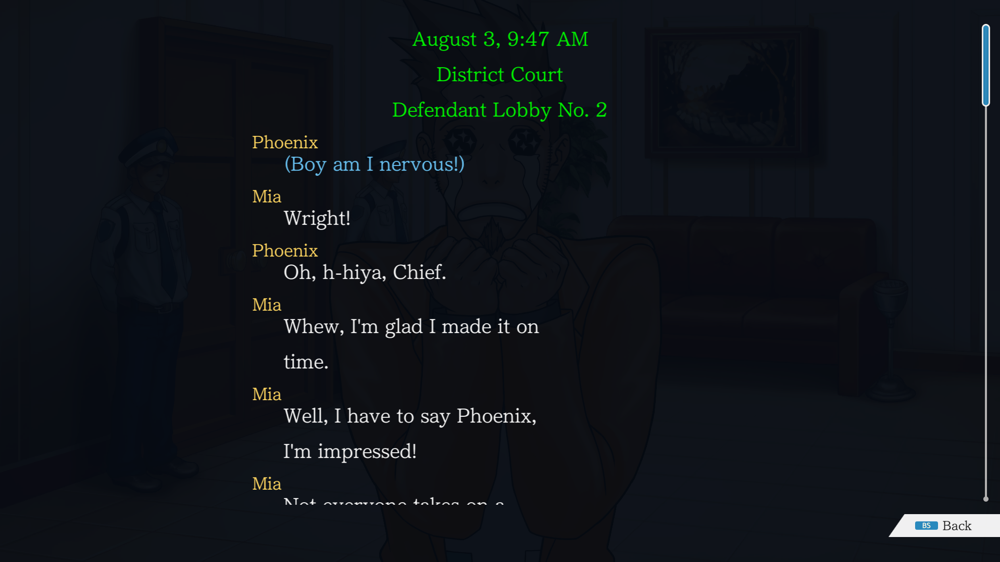

# Phoenix Wright: Ace Attorney Trilogy - xMod

[English](README.md) | [Español](README_es.md) | [Italiano](README_it.md) | [Português (BR)](README_pt.md) | **Français** | [Deutsch](README_de.md) | [日本語](README_ja.md) | [한국어](README_ko.md) | [简体中文](README_zh_cn.md) | [繁體中文](README_zh_tw.md)

**PWTrilogy-xMod** est une extension communautaire et mise à jour de contenu conçue pour transformer *Phoenix Wright: Ace Attorney Trilogy* en **édition définitive** du jeu.

Il s'agit d'un mod complet qui enrichit l'expérience avec de nouvelles salles interactives, des améliorations de confort (QoL), une bande-son orchestrale dynamique, la prise en charge native 64 bits sous Linux (Steam Deck) et Windows, ainsi qu'une coexistence multilingue sans altérer les langues officielles de CAPCOM.

---

## Fonctionnalités principales

### Nouvelles langues coexistantes
- **Espagnol européen** : Traduction, interface graphique et doublages adaptés par **Traducciones Kurain**.
- **Italien** : Localisation complète développée par **Dragon Punk Team**.

### Galerie des distinctions interactive (Accolades Gallery)

- Nouvelle salle interactive dans le menu **Galerie** avec des vitrines 3D et des cadres par catégorie (bronze, argent et or).
- **Synchronisation bidirectionnelle avec Steam** : Détecte et synchronise automatiquement les succès débloqués sur Steam, et permet d'envoyer vers votre compte les distinctions obtenues en jouant hors ligne.
- Notifications contextuelles en jeu lors du déblocage d'une distinction.

### Historique des dialogues

- Consultez les conversations précédentes à tout moment pendant la partie.

### Bande-son orchestrale en jeu
- Nouvelle option en jeu permettant d'alterner à tout moment entre la bande-son originale et les arrangements orchestraux tout au long de l'histoire.

### Salle de musique étendue

- Nouveaux morceaux ajoutés au lecteur musical de la Galerie, incluant l'album *« Gyakuten Meets Orchestra »*.

### Support multiplateforme natif 64 bits
- **Linux natif (64 bits)** : Exécutable et bibliothèques natifs avec rendu Vulkan/OpenGL, idéal pour les PC sous Linux et le **Steam Deck**.
- **Windows (64 bits et 32 bits)** : Environnements d'exécution 64 bits pour les processeurs modernes. L'environnement 32 bits d'origine est conservé pour garantir une compatibilité totale.

### Patcheur universel autonome (PWTrilogyPatcher)
- Interface graphique Avalonia UI traduite dans les **10 langues** du jeu (Español, Italiano, English, Português-BR, Français, Deutsch, 日本語, 한국어, 简体中文, 繁體中文).
- **Charge utile chiffrée intégrée** : Le patcheur embarque les données compressées protégées par chiffrement AES-256 et applique les deltas instantanément et en toute sécurité.

---

## Instructions d'installation

1. Rendez-vous sur la page **[Dernières versions (Releases)](https://github.com/CTPache/PWTrilogy-xMod/releases/latest)**.
2. Téléchargez l'installateur correspondant à votre système d'exploitation :
   - **Windows** : Téléchargez `AATrilogyPatcher.exe`.
   - **Linux / Steam Deck** : Téléchargez `AATrilogyPatcher-linux`.
3. Lancez le patcheur :
   - Sous Linux ou Steam Deck, assurez-vous de lui accorder les droits d'exécution avant de le lancer :
     ```bash
     chmod +x AATrilogyPatcher-linux
     ./AATrilogyPatcher-linux
     ```
4. Le patcheur détectera automatiquement le chemin d'installation Steam. S'il ne le trouve pas ou si vous utilisez un dossier personnalisé, saisissez le chemin manuellement.
5. Sélectionnez la version cible appropriée (Windows 32 bits, Windows 64 bits ou Linux 64 bits) puis cliquez sur **« Patcher »**.
6. Une fois terminé, lancez le jeu. S'il démarre dans une autre langue, changez-la selon votre préférence dans le menu **Options** $\rightarrow$ **Langue**.
   - Sous Linux, ajoutez cette ligne aux options de lancement Steam :
   ```
   sh -c 'exec ./PWAAT.x86_64' -- %command%
   ```

---

## Notes de mise à jour en jeu

Lors du premier lancement du jeu après l'application du xMod, une boîte de dialogue affichera automatiquement les notes de mise à jour dans votre langue active, résumant toutes les nouveautés ajoutées.

---

## Foire aux questions et dépannage

<details>
<summary><b>Le patcheur échoue à écrire des fichiers ou signale une erreur de permissions ?</b></summary>
Assurez-vous d'avoir placé l'exécutable dans un dossier disposant de droits d'écriture (comme votre Bureau ou votre dossier personnel) et que le jeu est complètement fermé avant de démarrer l'opération.
</details>

<details>
<summary><b>Mes sauvegardes sont-elles conservées ?</b></summary>
Oui. Le xMod préserve et étend les emplacements de sauvegarde (110 emplacements pour accueillir les 11 langues), en maintenant une compatibilité totale avec vos anciennes sauvegardes tout en ajoutant la persistance des distinctions.
</details>

<details>
<summary><b>Comment installer le mod sur Steam Deck ?</b></summary>
Passez en <i>Mode Bureau (Desktop Mode)</i> sur votre Steam Deck, téléchargez <code>AATrilogyPatcher-linux</code>, accordez-lui les permissions d'exécution et lancez-le pour patcher votre installation Steam. De retour en <i>Mode Jeu (Gaming Mode)</i>, toutes les améliorations seront actives.
</details>

---

## Crédits et remerciements

### Développement de PWTrilogy-xMod
- **Développement du mod, Romhacking & Ingénierie :** [CTPache](https://github.com/CTPache)
- **Développement du patcheur (Avalonia / Mara) :** [Worst Aqua Player](https://github.com/WorstAquaPlayer), [CTPache](https://github.com/CTPache), [legendaryX77](https://github.com/legendaryX77)
- **Design d'interface et ajustements de textes :** [JauCR](https://github.com/JauCR), [CTPache](https://github.com/CTPache)

### Traductions
- Espagnol : [Traducciones Kurain](https://github.com/Traducciones-Kurain/PWTrilogy-ESP/blob/master/README.md)
- Italien : [Dragon Punk Team](https://dragonpunkteam.altervista.org/phoenix-wright-ace-attorney-trilogy/)

### Remerciements particuliers
- À [Darkmet98](https://github.com/Darkmet98) pour la bibliothèque et les outils de patching Mara.
- À **Shu Takumi** pour avoir donné vie à la saga *Ace Attorney*.
