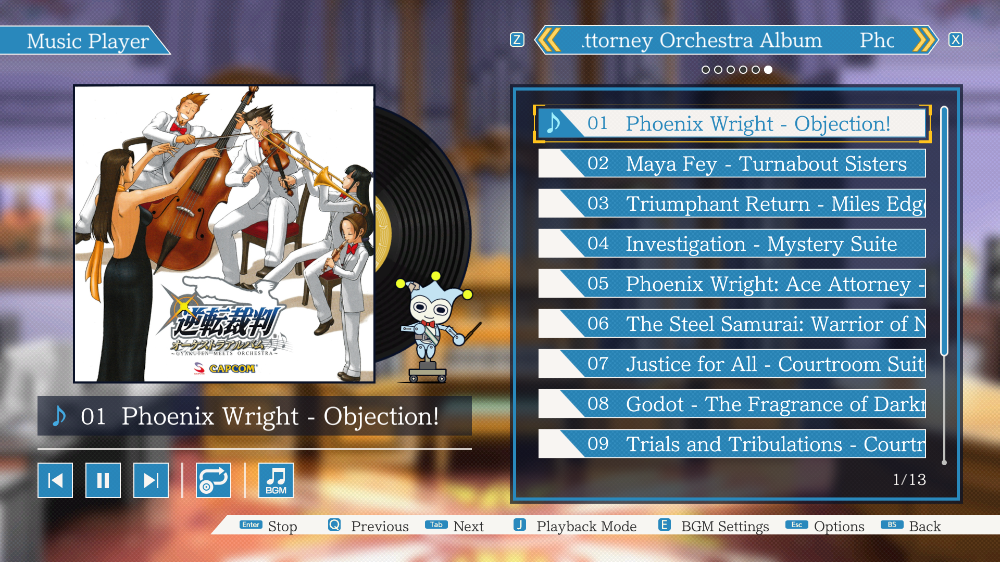

# Phoenix Wright: Ace Attorney Trilogy - xMod

[English](README.md) | [Español](README_es.md) | [Italiano](README_it.md) | **Português (BR)** | [Français](README_fr.md) | [Deutsch](README_de.md) | [日本語](README_ja.md) | [한국어](README_ko.md) | [简体中文](README_zh_cn.md) | [繁體中文](README_zh_tw.md)

**PWTrilogy-xMod** é uma expansão comunitária e atualização de conteúdo desenvolvida para transformar *Phoenix Wright: Ace Attorney Trilogy* na **edição definitiva** do jogo.

Trata-se de um mod completo que aprimora a experiência com novas salas interativas, melhorias de qualidade de vida (QoL), trilha sonora orquestral dinâmica, suporte nativo de 64 bits para Linux (Steam Deck) e Windows, além de coexistência multilíngue sem alterar os idiomas oficiais da CAPCOM.

---

## Principais recursos

### Novos idiomas coexistentes
- **Espanhol europeu**: Tradução, interface gráfica e vozes dubladas adaptadas pela **Traducciones Kurain**.
- **Italiano**: Localização completa desenvolvida pela **Dragon Punk Team**.

### Galeria de Conquistas Interativa (Accolades Gallery)

- Nova sala interativa no menu **Galeria** com vitrines 3D e molduras por categoria (bronze, prata e ouro).
- **Sincronização bidirecional com o Steam**: Detecta e sincroniza automaticamente as conquistas desbloqueadas no Steam, e permite enviar para sua conta as conquistas obtidas jogando offline.
- Notificações pop-up *in-game* ao desbloquear conquistas.

### Histórico de Diálogos

- Revise conversas anteriores a qualquer momento durante o jogo.

### Trilha Sonora Orquestral durante o jogo
- Nova opção no jogo para alternar entre a trilha sonora original e os arranjos orquestrais ao longo da história.

### Sala de Música Expandida

- Novas faixas adicionadas ao reprodutor de música da Galeria, incluindo o álbum *"Gyakuten Meets Orchestra"*.

### Suporte Multiplataforma Nativo de 64 bits
- **Linux Nativo (64-bit)**: Executável e bibliotecas nativas com renderização Vulkan/OpenGL, ideal para desktops Linux e **Steam Deck**.
- **Windows (64-bit e 32-bit)**: Runtimes de 64 bits para processadores modernos. O runtime original de 32 bits é mantido para total compatibilidade.

### Instalador Universal Autocontido (PWTrilogyPatcher)
- Interface gráfica em Avalonia UI traduzida para os **10 idiomas** do jogo (Español, Italiano, English, Português-BR, Français, Deutsch, 日本語, 한국어, 简体中文, 繁體中文).
- **Payload criptografado integrado**: O instalador contém os dados compactados e protegidos com criptografia AES-256, aplicando os deltas de forma imediata e segura.

---

## Instruções de Instalação

1. Acesse a aba **[Últimos Lançamentos (Releases)](https://github.com/CTPache/PWTrilogy-xMod/releases/latest)**.
2. Baixe o instalador correspondente ao seu sistema operacional:
   - **Windows**: Baixe `AATrilogyPatcher.exe`.
   - **Linux / Steam Deck**: Baixe `AATrilogyPatcher-linux`.
3. Execute o instalador de patch:
   - No Linux ou Steam Deck, certifique-se de conceder permissão de execução antes de executá-lo:
     ```bash
     chmod +x AATrilogyPatcher-linux
     ./AATrilogyPatcher-linux
     ```
4. O instalador detectará automaticamente o caminho de instalação do Steam. Caso não encontre ou você utilize um diretório personalizado, informe o caminho manualmente.
5. Selecione a versão de destino adequada (Windows 32-bit, Windows 64-bit ou Linux 64-bit) e clique em **"Instalar Patch"**.
6. Ao concluir, abra o jogo. Se ele iniciar em outro idioma, altere para o seu idioma preferido no menu **Opções** $\rightarrow$ **Idioma**.
   - No Linux, adicione esta linha às opções de inicialização do Steam:
   ```
   sh -c 'exec ./PWAAT.x86_64' -- %command%
   ```

---

## Notas da Atualização no Jogo

Ao iniciar o jogo pela primeira vez após aplicar o xMod, uma janela será exibida automaticamente com as notas da atualização no seu idioma ativo, resumindo todas as novidades adicionadas.

---

## Perguntas Frequentes e Solução de Problemas

<details>
<summary><b>O instalador falha ao gravar arquivos ou informa erro de permissão?</b></summary>
Certifique-se de ter extraído o executável em uma pasta com permissões de escrita do usuário (como a Área de Trabalho ou sua pasta pessoal) e que o jogo esteja completamente fechado antes de iniciar o processo.
</details>

<details>
<summary><b>Meus jogos salvos são preservados?</b></summary>
Sim. O xMod preserva e expande os slots de salvamento (110 slots para acomodar todos os 11 idiomas), mantendo compatibilidade total com seus saves anteriores e adicionando persistência às conquistas da galeria.
</details>

<details>
<summary><b>Como instalar no Steam Deck?</b></summary>
Entre no <i>Modo Área de Trabalho (Desktop Mode)</i> no seu Steam Deck, baixe o arquivo <code>AATrilogyPatcher-linux</code>, conceda permissão de execução e execute-o para aplicar o patch na sua instalação do Steam. Ao voltar para o <i>Modo Jogo (Gaming Mode)</i>, todas as melhorias estarão ativas.
</details>

---

## Créditos e Agradecimentos

### Desenvolvimento do PWTrilogy-xMod
- **Desenvolvimento do Mod, Romhacking e Engenharia:** [CTPache](https://github.com/CTPache)
- **Desenvolvimento do Patcher (Avalonia / Mara):** [Worst Aqua Player](https://github.com/WorstAquaPlayer), [CTPache](https://github.com/CTPache), [legendaryX77](https://github.com/legendaryX77)
- **Design de Interface e Ajustes de Texto:** [JauCR](https://github.com/JauCR), [CTPache](https://github.com/CTPache)

### Traduções
- Espanhol: [Traducciones Kurain](https://github.com/Traducciones-Kurain/PWTrilogy-ESP/blob/master/README.md)
- Italiano: [Dragon Punk Team](https://dragonpunkteam.altervista.org/phoenix-wright-ace-attorney-trilogy/)

### Agradecimentos Especiais
- A [Darkmet98](https://github.com/Darkmet98) pela biblioteca e ferramentas de patching Mara.
- A **Shu Takumi** por dar vida à série *Ace Attorney*.
